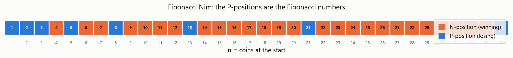

# Our Original Game — Fibonacci Nim

**Rules.** There is one pile of *n* coins. On the **first** move you may take any number from 1 to *n*−1. On every **later** move you may take between 1 and **twice** the number your opponent just took. The player who takes the last coin wins.

## 1. Experiment & Reasoning

By backward induction over the position (*n*, *r*) — *n* coins remaining and a limit *r* on how many you may take — the losing (P) positions for the first player are exactly the Fibonacci numbers

1, 2, 3, 5, 8, 13, 21, 34, …

(Figure 5).

*Figure 5. P/N positions of Fibonacci Nim: the P-positions are the Fibonacci numbers.*

## 2. Winning strategy

Write *n* as a sum of **non-adjacent Fibonacci numbers** (its **Zeckendorf representation**).

- If *n* is a Fibonacci number, you are in a losing (P) position.
- Otherwise, **take the smallest summand** in the representation; this leaves the opponent in a losing position.

Examples:

| n | Zeckendorf form | Take | Leave |
|---|---|---|---|
| 4 | 3 + 1 | 1 | 3 |
| 7 | 5 + 2 | 2 | 5 |
| 12 | 8 + 3 + 1 | 1 | 11 |
| 20 | 13 + 5 + 2 | 2 | 18 |
| 37 | 34 + 3 | 3 | 34 |

## 3. Proof

**Zeckendorf's theorem** states that every positive integer has a unique representation as a sum of non-adjacent Fibonacci numbers.

Write *n* = F_{a1} + F_{a2} + … + F_{ak} (with *a1* < *a2* < … < *ak*, no two adjacent), where F_{a1} is the smallest summand. **Whinihan's theorem** states that a position with *n* coins and limit *r* is a **P-position if and only if *r* < F_{a1}**.

- **From a P-position (*r* < F_{a1}).** Any legal take *t* satisfies *t* ≤ *r* < F_{a1}. A standard Zeckendorf fact says the remainder *n* − *t* then has its smallest summand at most *t*; hence the opponent's new limit 2*t* is at least that summand, so the opponent is in a winning (N) position. Every move therefore leaves P.
- **From an N-position (*r* ≥ F_{a1}).** Take F_{a1} coins. If *n* is a single Fibonacci number, this takes the whole pile and wins at once. Otherwise the remainder *n* − F_{a1} = F_{a2} + … + F_{ak} has smallest summand F_{a2}; since *a2* ≥ *a1* + 2, we have F_{a2} > 2F_{a1}. The opponent's new limit is 2F_{a1} < F_{a2}, so the opponent is in a P-position. There is therefore a move to P.

The **initial position** is (*n*, *n*−1). If *n* = F_{a1} is a Fibonacci number, then *r* = *n*−1 < *n* = F_{a1}, so the first player is in a P-position and loses. If *n* is not a Fibonacci number, then *n* ≥ F_{a1} + F_{a1+2} > 2F_{a1}, so *r* = *n*−1 ≥ F_{a1} and the first player wins by taking F_{a1}.

**Verification:** The program checked the full rule on 7320 positions (*n* ≤ 60, *r* ≤ 120) and the Zeckendorf winning move on every non-Fibonacci *n* up to 60 — all match. [1][2]

## References

- Whinihan, M. J. (1963). Fibonacci Nim. *The Fibonacci Quarterly*, 1(4), 9–13.
- Zeckendorf, E. (1972). Représentation des nombres naturels par une somme de nombres de Fibonacci ou de nombres de Lucas. *Bulletin de la Société Royale des Sciences de Liège*, 41, 179–182.
