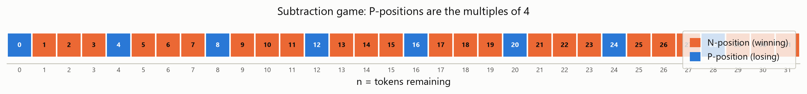
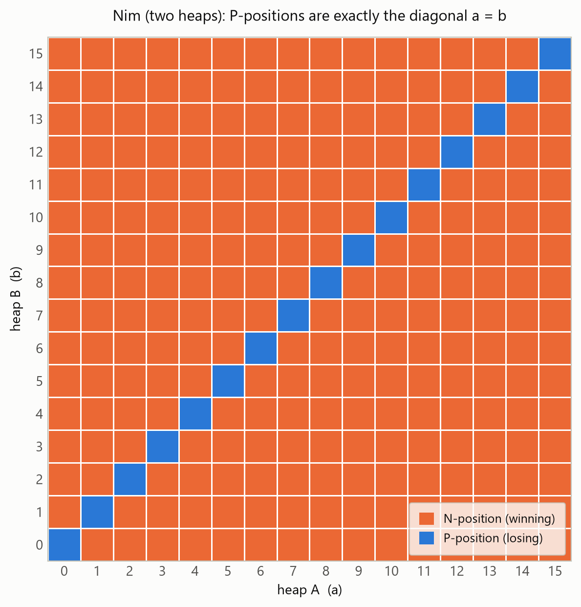
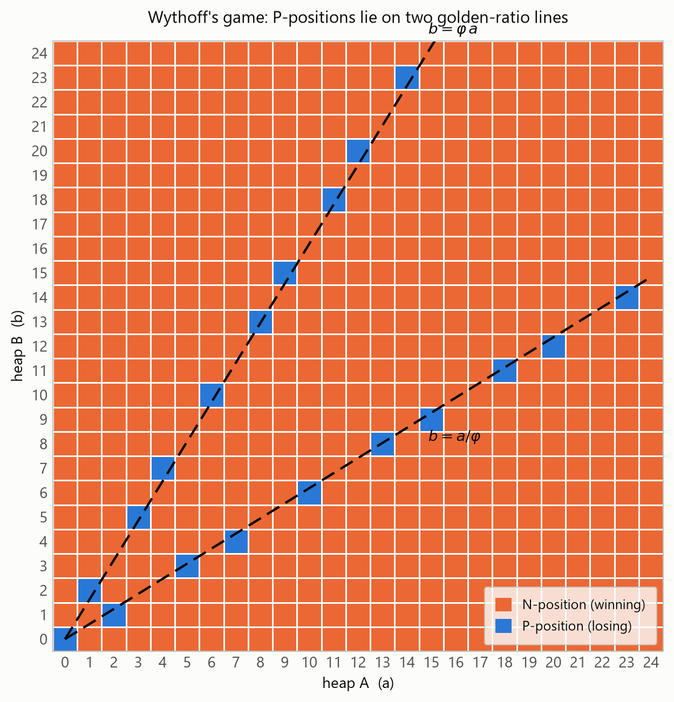
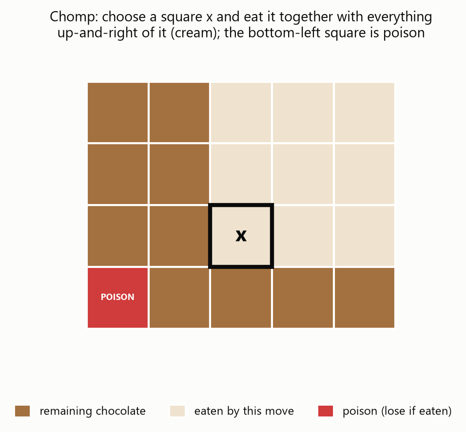

# P023 · Can You Build an Unbeatable Game?

*Winning and Losing Positions in Two-Player Strategy Games*

**Abstract:** This report studies four classic two-player strategy games — the subtraction game, Nim, Wythoff's game and Chomp game. For each game we enumerate small positions by backward induction, infer the pattern of winning (N) and losing (P) positions from the results, give a proof, and state a winning strategy that is verified by computer. Together we find out that the games reveal a single unifying result — the Sprague–Grundy theorem — which lays the foundation for the next step, designing an original unbeatable game.

## 1. Background Knowledge: P-positions and N-positions

We study impartial, perfect-information, without randomness two-player games under the normal convention: the player who takes the last token wins.

Every position falls into one of two classes, depending on whose turn it is:

| Notation | Name | Meaning |
|---|---|---|
| N-position | Next player wins | The player about to move has a winning strategy |
| P-position | Previous player wins | The player about to move is bound to lose |

Three rules uniquely determine every position (backward induction):

- The terminal position (no move available) is a P-position;
- A position is an N-position if and only if there is at least one move to a P-position;
- A position is a P-position if and only if every move leads to an N-position.

## 2. Game 1: The Subtraction Game

Rules: There is a single heap of n tokens. Players each move removes 1, 2, or 3 tokens (move set S = {1,2,3}), and the player who takes the last token wins.

### 2.1 Experiment & Reasoning

By backward induction over n = 0, …, 31, the P-positions are exactly {0, 4, 8, 12, 16, 20, 24, 28} — the multiples of 4 (Figure 1).

*Figure 1. P/N positions of the subtraction game S={1,2,3}.*

The pattern shows that in general, for the move set S = {1, 2, …, k}, the P-positions are exactly the multiples of k+1. Here k = 3, so they are the multiples of 4.

### 2.2 Winning strategy

Let r = n mod (k+1):

- If r = 0, the position is P (losing);
- If r > 0, remove r tokens, leaving a multiple of k+1 and handing your opponent a P-position.

Example (k = 3):

| Current n | r = n mod 4 | Take | Leave |
|---|---|---|---|
| 11 | 3 | 3 | 8 (P) |
| 9 | 1 | 1 | 8 (P) |
| 8 | 0 | — | — |

### 2.4 Proof

- If n is a multiple of k+1, then after removing x ∈ {1,…,k}, the remainder n−x is congruent to (k+1)−x ∈ {1,…,k}, not a multiple of k+1cannot leave your opponent a P-position;
- If n is not a multiple of k+1, remove the remainder r and you leave a multiple of k+1 (a P-position).

This is a periodic game with period k+1, one of the simplest kind of two-player strategy games. [5][6][7]

## 3. Game 2: Nim

Rules: There are several heaps (this report analyzes two heaps (a, b)). Each participant move removes any positive number of tokens from a single heap, and the player who takes the last token wins.

### 3.1 Experiment & Reasoning

By backward induction over a, b = 0, …, 15, the P-positions are exactly the main diagonal a = b (Figure 2).

*Figure 2. P/N positions of two-heap Nim*

Nim-sum (symbol ⊕) represents each heap in binary form, with 0 indicating a losing P situation and non-zero value representing a winning N situation. According to Bouton's theorem, in two-heap Nim (a, b) is a P-position if and only if a ⊕ b = 0. Since a ⊕ b = 0 ⟺ a = b, this matches the diagonal found by enumeration.

The same rule holds for several heaps: (a₁, …, aₘ) is a P-position if and only if a₁ ⊕ a₂ ⊕ … ⊕ aₘ = 0.

### 3.2 Winning strategy

Compute the nim-sum s = a₁ ⊕ … ⊕ aₘ:

- If s = 0, the position is P (losing);
- If s ≠ 0, let k be the highest set bit of s. Choose a heap aᵢ whose k-th bit is 1 and reduce it to aᵢ′ = aᵢ ⊕ s (necessarily aᵢ′ < aᵢ, so the move is legal). The new nim-sum becomes 0, handing your opponent a P-position.

Example (two heaps):

| Position (a,b) | nim-sum s | Move |
|---|---|---|
| (3, 5) | 6 | reduce 5 → 3, giving (3,3) |
| (12, 4) | 8 | reduce 12 → 4, giving (4,4) |
| (9, 2) | 11 | reduce 9 → 2, giving (2,2) |

### 3.3 Proof

For the two piles, a mirroring strategy is employed. If a = b, the second player wins by mirroring: whatever the first player removes from one heap, the second removes the same number from the other, keeping the heaps equal and eventually taking the last token. If a ≠ b, the first player removes enough from the larger heap to make them equal, then mirrors.

Bouton's theorem

**Theorem 1.** If the nim-sum is 0, every legal move makes it non-zero.

*Proof.* A move changes exactly one heap, aᵢ → aᵢ′ ≠ aᵢ; the new nim-sum is s′ = s ⊕ aᵢ ⊕ aᵢ′ = aᵢ ⊕ aᵢ′ ≠ 0 (because aᵢ′ ≠ aᵢ).

**Theorem 2.** If the nim-sum s ≠ 0, there is a move that makes it 0.

*Proof.* Let 2^d be the highest (leftmost) bit where s has a 1. Some heap aᵢ must also carry a 1 in position 2^d — otherwise s would carry a 0 there. Set aᵢ′ = aᵢ ⊕ s. To the left of 2^d, s has all 0s, so aᵢ′ agrees with aᵢ there; at 2^d, both aᵢ and s carry 1, so aᵢ′ carries 0. Hence aᵢ′ < aᵢ, so reducing heap i to aᵢ′ is a legal move, and the new nim-sum is s′ = s ⊕ aᵢ ⊕ aᵢ′ = s ⊕ s = 0.

Verification: the program compared all 16×16 = 256 positions; the enumeration matches "a ⊕ b = 0" in every cell. [1]

## 4. Game 3: Wythoff's Game

Rules: There are two heaps (a, b). The player's move is one of three kinds: remove any positive number from the first heap, remove any positive number from the second heap, or remove the same number from both heaps. The player who takes the last token wins.

### 4.1 Experiment & Reasoning

By backward induction over a, b = 0, …, 24, the P-positions (sorted with a ≤ b) are:

(0,0), (1,2), (3,5), (4,7), (6,10), (8,13), (9,15), (11,18), (12,20), (14,23), … (Figure 3, blue cells, lying on two golden-ratio lines.)

*Figure 3. P/N positions of Wythoff's game*

The golden ratio: Let φ = (1+√5)/2 ≈ 1.618 (with φ² = φ+1). The P-positions are exactly

(aₙ, bₙ) = (⌊nφ⌋, ⌊nφ²⌋),  n = 0, 1, 2, …

### 4.2 Winning strategy

Let x = min(a,b), y = max(a,b), d = y − x, and t = ⌊dφ⌋:

- If x = t, the position is P (losing);
- If x > t, remove x − t from both heaps, reaching (⌊dφ⌋, ⌊dφ²⌋) — a P-position;
- If x < t, then x is a lower number aₙ = ⌊nφ⌋ or an upper number bₙ = ⌊nφ²⌋. Set the larger heap to x's Wythoff partner:
  - if x = aₙ: set the larger heap y → bₙ = ⌊nφ²⌋, giving (aₙ, bₙ);
  - if x = bₙ: set the larger heap y → aₙ = ⌊nφ⌋, giving (bₙ, aₙ) — the mirrored P-position.

Example:

| Position (x,y) | d | ⌊dφ⌋ | Relation | Move |
|---|---|---|---|---|
| (1, 3) | 2 | 3 | x < ⌊dφ⌋, x = a₁ | larger heap 3 → 2, giving (1,2) |
| (2, 5) | 3 | 4 | x < ⌊dφ⌋, x = b₁ | larger heap 5 → 1, giving (1,2) |
| (5, 8) | 3 | 4 | x > ⌊dφ⌋ | remove 1 from both, giving (4,7) |
| (6, 6) | 0 | 0 | x > ⌊dφ⌋ | remove 6 from both, giving (0,0) |

### 4.3 Proof

Constructing the P-positions. Set a₀ = b₀ = 0; then take aₖ to be the smallest positive integer not yet used among a₀,…,aₖ₋₁,b₀,…,bₖ₋₁, and put bₖ = aₖ + k. This greedy rule produces (0,0), (1,2), (3,5), (4,7), … — exactly the enumeration above.

Why this is the golden-ratio rule. By Beatty's theorem, since φ and φ² satisfy 1/φ + 1/φ² = 1, the two sequences ⌊kφ⌋ and ⌊kφ²⌋ partition the positive integers — every integer appears in exactly one of them. Moreover bₖ = ⌊kφ²⌋ = ⌊kφ⌋ + k = aₖ + k, so the greedy construction and the golden-ratio formula agree.

**Lemma 1** — a P-position cannot move to a P-position.

- Removing from one heap leaves the other coordinate unchanged, but no integer appears in two different P-positions, so the result cannot be a P-position;
- Removing equally from both heaps preserves the difference b − a, but different P-positions have different differences (bₖ − aₖ = k), so again the result is not a P-position.

**Lemma 2** — every N-position can move to a P-position. This is precisely the winning strategy of Section 4.2, which the program verified on all 625 positions.

Lemmas 1 and 2 together confirm that the P-positions are exactly the golden-ratio pairs (⌊nφ⌋, ⌊nφ²⌋). [2][8]

## 5. Chomp game — a Puzzle for the Audience

Rule: Chomp is played on a chocolate bar of m×n squares whose bottom-left square is poisoned. A move chooses a square and eats it together with everything up-and-right of it. Whoever is forced to eat the poisoned square loses.

*Figure 4. A chocolate board in Chomp.*

Claim: except for the 1×1 bar (where the first player must eat the poison and loses), the first player always has a winning strategy.

Proof (strategy stealing, non-constructive). Suppose, for contradiction, that the second player has a winning strategy. The first player eats only the top-right square. By assumption, the second player then has a winning reply, eating some square x. But the first player could have opened by eating x directly: eating x removes everything up-and-right of it, which already includes the top-right square, so the position reached is exactly the one after "top-right, then x." That position is losing for whoever moves next — but after opening with x, the first player leaves that same losing position to the second player, a contradiction. Hence the first player wins.

The catch: this proof shows the first player wins without saying how — the optimal first move on a general board is still an open problem. It is a nice contrast to the explicit, computable strategies we built for the first three games.

Audience challenge: on a 2×3 or 3×3 bar, can you find the first player's winning move?

## 6. One Rule Behind All Three Games: the Sprague–Grundy Theorem

| Game | P-positions | Tool | Complexity |
|---|---|---|---|
| Subtraction S={1,2,3} | n ≡ 0 (mod 4) | periodicity mod k+1 | simple period |
| Nim (two heaps) | a ⊕ b = 0 | nim-sum (XOR) | binary |
| Wythoff (two heaps) | (⌊nφ⌋, ⌊nφ²⌋) | golden ratio / Beatty | irrational |

The unifying result is the Sprague–Grundy theorem: in every impartial game under normal play, each position is equivalent to a single Nim heap; the size of that equivalent heap is its Grundy value (SG value / nimber), computed recursively by the mex (minimum excluded) rule. It turns "find a winning strategy" into "compute SG values" — the core tool for designing an original game and finding its winning strategy. [3][4]

## 7. Verification Supports

- The enumeration and winning strategies are implemented in code and verified position by position: 32 positions for the subtraction game, 256 for Nim, and 625 for Wythoff. The strategy "names a legal move to a P-position from every N-position, and none from every P-position" passes on all of them (see results.txt).
- For all python scripts and results, please reference LydiaLiYaQiu/P023_unbeatable_game: Impartial game analysis: Subtraction game, Nim, Wythoff's game, Chomp.

## 8. References

[1] Bouton, C. L. (1901). Nim, a game with a complete mathematical theory. Annals of Mathematics, 3(1), 35–39. DOI: 10.2307/1967631.

[2] Wythoff, W. A. (1907). A modification of the game of Nim. Nieuw Archief voor Wiskunde (2), 7, 199–202.

[3] Sprague, R. (1935). Über mathematische Kampfspiele. Tôhoku Mathematical Journal, 41, 438–444.

[4] Grundy, P. M. (1939). Mathematics and games. Eureka, 2, 6–8.

[5] Golomb, S. W. (1966). A mathematical investigation of games of "take-away". Journal of Combinatorial Theory, 1(4), 443–458. DOI: 10.1016/S0021-9800(66)80016-9.

[6] Conway, J. H. (1976). On Numbers and Games. Academic Press.

[7] Berlekamp, E. R., Conway, J. H., & Guy, R. K. (1982). Winning Ways for Your Mathematical Plays. Academic Press.

[8] Wolfram MathWorld. Wythoff Sequence. https://mathworld.wolfram.com/WythoffSequence.html.
